# TP Snake
Toutes les parties du TP ont été faites en groupe par :

- Matteo Belin
- Katel Hignard
- Adrien Dhommeaux

## Exercice 1 - Jeu de base

### 1. Implémentez une classe ShortSnake avec comme argument la taille de la grille. Son constructeur instancie une grille qui représentera la zone de jeu.

```python
class ShortSnake:
    def __init__(self,taille):
        self.taille = taille
        self.grille = []
        for i in range(taille):
            ligne = [0] * taille
            self.grille.append(ligne)

```

### 2. Dans le constructeur, rajoutez la position et la direction initiale du serpent dans des attributs snake_pos et snake_dir. Par défaut, il sera au milieu du jeu.

```python
# dans direction.py
from enum import Enum

class Direction(Enum):
    NORTH = 0
    EAST = 1
    SOUTH = 2
    WEST = 3
```


```python
from direction import Direction
from action import Action

class ShortSnake:
    def __init__(self,taille):
        self.taille = taille
        self.grille = []

        self.snake_pos = (taille // 2, taille // 2)
        self.snake_dir = Direction.EAST
```


### 3. Rajoutez un attribut fruit_pos indiquant les coordonnées du fruit. Les coordonnées seront choisies aléatoirement.

```python
from random import randint

def _generer_fruit(self):
    self.fruit_pos = self.snake_pos
    while(self.fruit_pos == self.snake_pos):
        self.fruit_pos = (randint(0, self.taille - 1), randint(0, self.taille - 1))
```

### 4. Rajoutez un attribut score initialement à 0.

```python
from direction import Direction
from random import randint
from action import Action

class ShortSnake:
    def __init__(self,taille):
        self.taille = taille
        self.grille = []

        self.snake_pos = (taille // 2, taille // 2)
        self.snake_dir = Direction.EAST
        self._generer_fruit()
        self.score = 0
```

### 5. Rajoutez une méthode move qui prend en argument la direction vers laquelle aller, ou None pour ne rien faire et continuer à avancer. Elle doit déplacer la tête du serpent. Attention, on ne peut pas repartir en arrière de la direction de mouvement actuelle.

```python
def move(self, action: Action):
        x, y = self.snake_pos

        match action:
            case Action.RIGHT:
                match self.snake_dir:
                    case Direction.NORTH : self.snake_dir = Direction.EAST
                    case Direction.EAST : self.snake_dir = Direction.SOUTH
                    case Direction.SOUTH : self.snake_dir = Direction.WEST
                    case Direction.WEST : self.snake_dir = Direction.NORTH
            case Action.LEFT:
                match self.snake_dir:
                    case Direction.NORTH : self.snake_dir = Direction.WEST
                    case Direction.EAST : self.snake_dir = Direction.NORTH
                    case Direction.SOUTH : self.snake_dir = Direction.EAST
                    case Direction.WEST : self.snake_dir = Direction.SOUTH

        match self.snake_dir:
            case Direction.WEST:  x -= 1
            case Direction.EAST:  x += 1
            case Direction.NORTH: y -= 1
            case Direction.SOUTH: y += 1
```

### 6. Dans la méthode move, si un bord est atteint, le serpent doit réapparaître de l’autre côté et perdre 10 points.

```python
def move(self, action: Action):
        x, y = self.snake_pos

        match action:
            case Action.RIGHT:
                match self.snake_dir:
                    case Direction.NORTH : self.snake_dir = Direction.EAST
                    case Direction.EAST : self.snake_dir = Direction.SOUTH
                    case Direction.SOUTH : self.snake_dir = Direction.WEST
                    case Direction.WEST : self.snake_dir = Direction.NORTH
            case Action.LEFT:
                match self.snake_dir:
                    case Direction.NORTH : self.snake_dir = Direction.WEST
                    case Direction.EAST : self.snake_dir = Direction.NORTH
                    case Direction.SOUTH : self.snake_dir = Direction.EAST
                    case Direction.WEST : self.snake_dir = Direction.SOUTH

        match self.snake_dir:
            case Direction.WEST:  x -= 1
            case Direction.EAST:  x += 1
            case Direction.NORTH: y -= 1
            case Direction.SOUTH: y += 1

        # Contrôle de la position hors grille    
        if x < 0:
            self.score -= 10
            x = self.taille - 1
        elif x >= self.taille:
            self.score -= 10
            x = 0
        elif y < 0:
            self.score -= 10
            y = self.taille - 1
        elif y >= self.taille:
            self.score -= 10
            y = 0
        
        self.snake_pos = (x, y)
```

### 7. Dans la méthode move, si la nouvelle position est celle du fruit, le score augmente de 10 points et un nouveau fruit est placé aléatoirement.


```python
def move(self, action: Action):
        x, y = self.snake_pos

        match action:
            case Action.RIGHT:
                match self.snake_dir:
                    case Direction.NORTH : self.snake_dir = Direction.EAST
                    case Direction.EAST : self.snake_dir = Direction.SOUTH
                    case Direction.SOUTH : self.snake_dir = Direction.WEST
                    case Direction.WEST : self.snake_dir = Direction.NORTH
            case Action.LEFT:
                match self.snake_dir:
                    case Direction.NORTH : self.snake_dir = Direction.WEST
                    case Direction.EAST : self.snake_dir = Direction.NORTH
                    case Direction.SOUTH : self.snake_dir = Direction.EAST
                    case Direction.WEST : self.snake_dir = Direction.SOUTH

        match self.snake_dir:
            case Direction.WEST:  x -= 1
            case Direction.EAST:  x += 1
            case Direction.NORTH: y -= 1
            case Direction.SOUTH: y += 1

        if x < 0:
            self.score -= 10
            x = self.taille - 1
        elif x >= self.taille:
            self.score -= 10
            x = 0
        elif y < 0:
            self.score -= 10
            y = self.taille - 1
        elif y >= self.taille:
            self.score -= 10
            y = 0
        
        self.snake_pos = (x, y)
        
        x_fruit, y_fruit = self.fruit_pos
        if(x ==x_fruit and y==y_fruit) :
            self.score += 10
            self._generer_fruit()
```

### 8. Ajoutez une méthode __str__ qui affiche la grille de jeu et le score.
```python
def __str__(self):
        affichage ="\n"
        for ligne in self.grille:
            affichage += "|" + "|".join(ligne) + "|\n"

        affichage += "Score : " + str(self.score)
        return affichage
```

## Exercice 2 - Modélisation du MDP

### 1. Quelles informations constituent les états du MDP ?
- La position du snake
- La direction du snake
- La position du fruit

### 2. Pour une grille 10 x 10, combien y a-t-il d’états possibles ?
10 * 10 (position du snake) * 4 (direction) * 99 (position du fruit qui ne peut pas etre sur le snake) = 39 600

### 3. Et pour une grille 𝑁 × 𝑀 ?
N * M * 4 * (N * M - 1)

### 4. Quelles sont les actions du MDP ?
- Continuer d'avancer
- Tourner à droite
- Tourner à gauche

### 5. Les actions sont-elles différentes en fonction de l’état ?
Les actions ne changent pas en fonction de l'état c'est toujours :
- Continuer d'avancer
- Tourner à droite
- Tourner à gauche

### 6. Quelles sont les récompenses du MDP ?
- +10 quand le snake mange le fruit
- -10 quand le snake se prend un bord
- 0 quand le snake se déplace

### 7. Représentez graphiquement le MDP pour quelques états. Montrez au moins 1 cycle entre états.

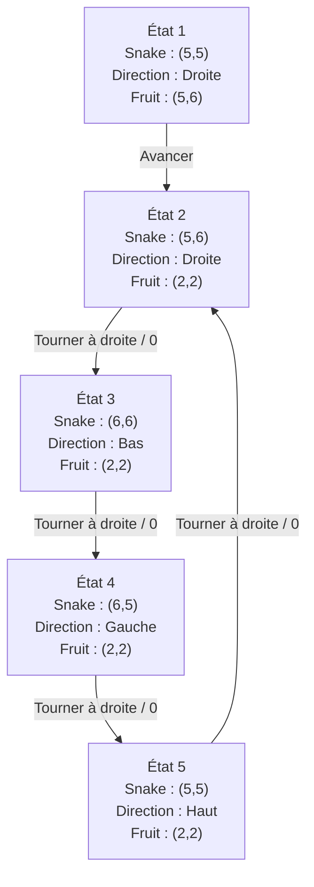


## Exercice 3 - Implémentation du Q-Learning

### 1. Rajoutez une méthode save_state à votre classe ShortSnake qui renvoie un tuple qui contient toutes les informations représentant l’état actuel du jeu.

```python
def save_state(self):
    return (self.snake_pos, self.snake_dir, self.fruit_pos)
```

On renvoie un tuple car il sert de clé dans le dictionnaire de l'IA (un dictionnaire Python ne peut pas servir de clé). Le score et la taille de la grille ne sont pas dans le tuple : ils ne font pas partie de l'état du MDP (voir l'exercice 2). Avec le score, l'IA ne retomberait presque jamais sur le même état.

###  2. Rajoutez une méthode restore_state à votre classe ShortSnake qui restaure l’état précédemment restauré.
```python
def restore_state(self, state):
    self.snake_pos, self.snake_dir, self.fruit_pos = state
```

### 3. Rappelez la formule de mise à jour du Q-Learning.

$$Q(s_t,a_t)=(1 - \alpha)Q(s_t, a_t) + \alpha(R_t + \gamma \max Q(s_{t + 1}, a))$$

### 4. Reprenez la base de la classe GreedyPlayer du TP précédent qui implémente la stratégie 𝜀-greedy. Vous aurez essentiellement besoin de changer _greedy_action, reward et le constructeur.

```python
from random import random, randrange, choice


class GreedyPlayer:
    def __init__(self, n, eps):
        self.n = n
        self.eps = eps

        self.action_values = [0] * n
        self.eval_count = [0] * n

    def get_action(self):
        random_value = random()
        explore = random_value < self.eps
                                                                                                                                                                                
        return self._random_action() if explore else self._greedy_action()

    def _greedy_action(self):
        max_action_ids = []
        max_action_value = max(self.action_values)

        for i in range(len(self.action_values)) :
            if self.action_values[i] == max_action_value :
                max_action_ids.append(i)

        return choice(max_action_ids)

    def _random_action(self):
        return randrange(self.n)


    def reward(self, action, reward):
        self.eval_count[action] += 1
        self.action_values[action] += (reward - self.action_values[action]) / self.eval_count[action]
```

### 5. Rajoutez un argument à votre constructeur qui sera une instance de ShortSnake.

```python
class GreedyPlayer:
    def __init__(self, snake, eps):
        self.snake = snake
        self.eps = eps
 
```

### 6. Votre tableau Q (probablement nommé action_values) ne sera plus indexé par des actions, mais par des paires (état, action).
```python
class GreedyPlayer:
    def __init__(self, snake, eps):
        self.snake = snake
        self.eps = eps

        self.action_values = {}
        self.eval_count = {}
```


### 7. Modifiez votre méthode _greedy_action pour prendre en compte l’état actuel en plus des actions.

```python
from random import random, choice
from action import Action

ACTIONS = [None, Action.LEFT, Action.RIGHT]

def get_action(self):
    self.state = self.snake.save_state()

    random_value = random()
    explore = random_value < self.eps

    return self._random_action() if explore else self._greedy_action()

def _value(self, state, action):
    return self.action_values.get((state, action), 0)

def _greedy_action(self):
    max_action_ids = []
    max_action_value = max(self._value(self.state, action) for action in ACTIONS)

    for action in ACTIONS:
        if self._value(self.state, action) == max_action_value:
            max_action_ids.append(action)

    return choice(max_action_ids)

def _random_action(self):
    return choice(ACTIONS)
```

### 8. Modifiez la méthode reward afin de mettre à jour votre estimation du retour selon la formule du Q-Learning. Vous utiliserez un facteur d’actualisation de 0.5 pour le moment.

```python
class GreedyPlayer:
    def __init__(self, snake, eps, gamma=0.5):
        self.snake = snake
        self.eps = eps
        self.gamma = gamma

        self.action_values = {}
        self.eval_count = {}
        self.state = snake.save_state()
```

```python
def reward(self, action, reward):
    next_state = self.snake.save_state()
    key = (self.state, action)

    self.eval_count[key] = self.eval_count.get(key, 0) + 1
    alpha = 1 / self.eval_count[key]

    best_next_value = max(self._value(next_state, a) for a in ACTIONS)
    target = reward + self.gamma * best_next_value

    self.action_values[key] = (1 - alpha) * self._value(self.state, action) + alpha * target
```

### 9. Implémentez le programme principal qui fait jouer votre IA.

```python
def play(player, snake, steps):
    rewards = []

    for step in range(steps):
        action = player.get_action()
        old_score = snake.score
        snake.move(action)
        reward = snake.score - old_score
        player.reward(action, reward)
        rewards.append(reward)

    return rewards

snake = ShortSnake(5)
player = GreedyPlayer(snake, 0.1)
play(player, snake, 1000)
print(snake)
```

### 10. Tracez le graphique l’évolution de la récompense au cours des 1000 premières étapes.

```python
snake = ShortSnake(5)
player = GreedyPlayer(snake, 0.1)
rewards = play(player, snake, 1000)

plt.plot(rewards)
plt.title("Récompense d'une seule IA")
plt.xlabel("Étape")
plt.ylabel("Récompense")
plt.show()
```

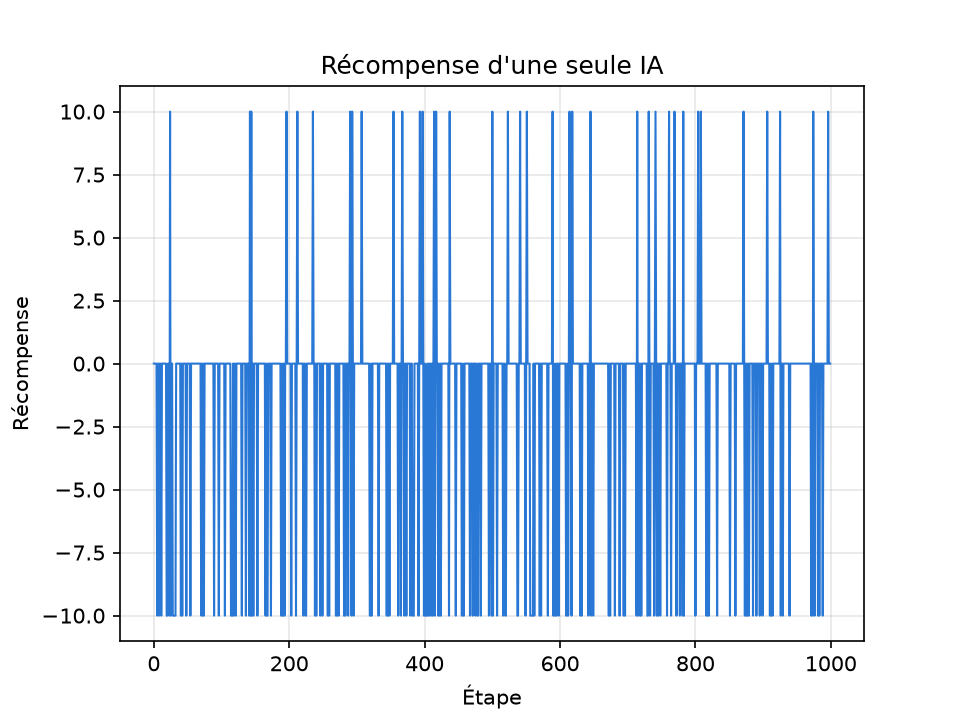

La récompense vaut toujours 0, 10 ou -10, donc le graphique est très bruité et on ne voit pas d'évolution. Nous observons qu'une grande majorité touche le bord car la grille fait du 5*5.

### 11. Pour lisser le bruit, relancez votre IA plusieurs fois. (Faites des tests pour choisir combien de fois relancer l’IA.)

```python
def simulate(gamma, steps, runs, size=5):
    total_rewards = [0] * steps
    run_means = []

    for run in range(runs):
        snake = ShortSnake(size)
        player = GreedyPlayer(snake, 0.1, gamma)
        rewards = play(player, snake, steps)

        for step in range(steps):
            total_rewards[step] += rewards[step]
        run_means.append(mean(rewards))

    avg_rewards = [total / runs for total in total_rewards]
    return avg_rewards, run_means
```

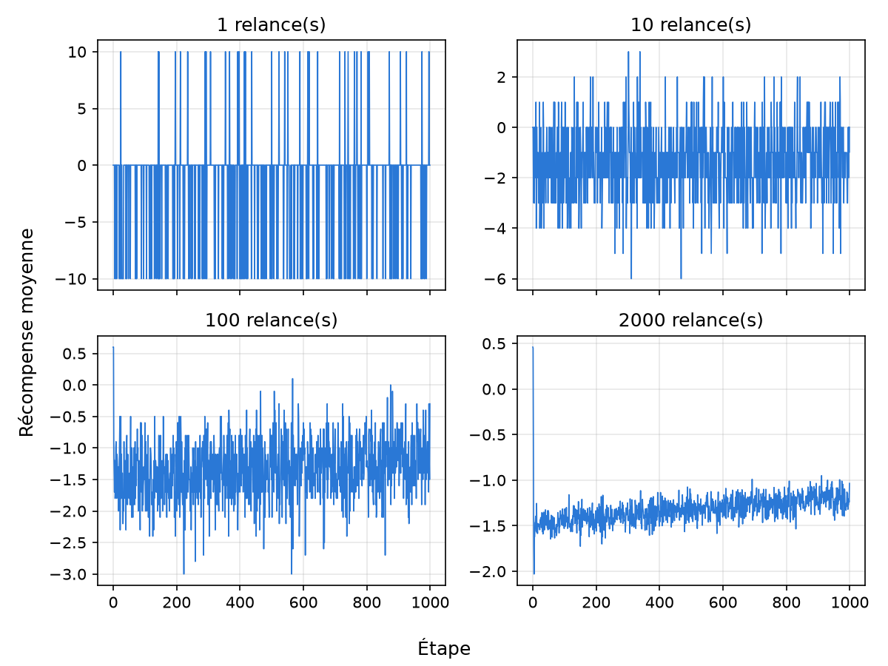

| Relances | Écart-type de la courbe | Erreur type de la moyenne |
|------|------|------|
| 1 | 4.46 | - |
| 10 | 1.39 | 0.047 |
| 100 | 0.47 | 0.012 |
| 500 | 0.24 | 0.006 |
| 2000 | 0.15 | 0.003 |
| 10000 | 0.13 | 0.001 |

Le bruit diminue avec le nombre de relances. Nous gardons 2000 relance car 10000 prend 5 fois plus de temps pour un gain faible sur la courbe.

Avec 2000 relances, on voit que la récompense augmente doucement, d'environ -1.45 à -1.2. Le pic du début vient de la position de départ, comme le serpent démarre au centre il peut manger un fruit à la première étape, mais il ne peut toucher un bord qu'à partir de la troisième étape.

### 12. Recommencez pour plusieurs valeurs du facteur d’actualisation : 0, 0.1, 0.5, 0.9 et 1. Quelle est la meilleure valeur ?

```python
def simulate_all(jobs):
    with Pool() as pool:
        return pool.starmap(simulate, jobs)

gammas = [0, 0.1, 0.5, 0.9, 1]
results = simulate_all([(gamma, 1000, 2000) for gamma in gammas])

for i in range(len(gammas)):
    avg_rewards, run_means = results[i]
    smooth = moving_average(avg_rewards, 50)
    plt.plot(range(49, 1000), smooth, label=f"γ = {gammas[i]}")
```

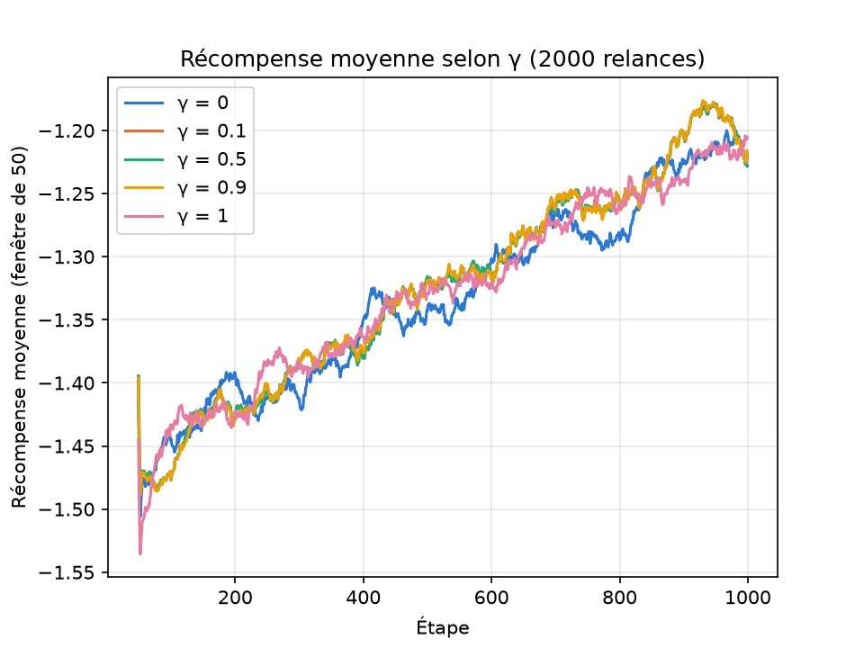

Moyennes obtenues sur 2000 relances (erreur type de 0.003) :

| 𝛾 | Récompense moyenne sur les 1000 étapes | Récompense moyenne sur les 100 dernières étapes |
|------|------|------|
| 0 | -1.331 | -1.219 |
| 0.1 | -1.322 | -1.200 |
| 0.5 | -1.322 | -1.200 |
| 0.9 | -1.322 | -1.199 |
| 1 | -1.327 | -1.210 |

Les meilleures valeurs sont 0.1, 0.5 et 0.9, qui sont à égalité (leurs courbes se superposent). Mais l'écart avec 0 et 1 est très faible, de l'ordre de 0.01 : sur 1000 étapes, 𝛾 n'a presque aucun effet.

### 13. Recherchez la meilleure valeur. Quelle est-elle ?
```python
gammas = [i / 20 for i in range(21)]
results = simulate_all([(gamma, 1000, 10000) for gamma in gammas])
```

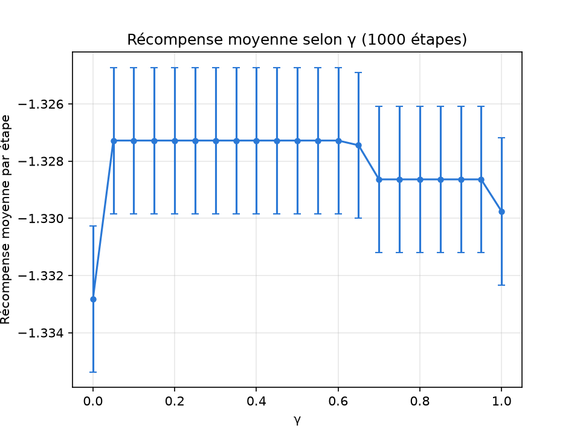

| 𝛾 | Récompense moyenne |
|------|------|
| 0 | -1.3328 |
| 0.05 à 0.60 | -1.3273 |
| 0.65 | -1.3274 |
| 0.70 à 0.95 | -1.3286 |
| 1 | -1.3298 |

Toutes les valeurs de 𝛾 entre 0.05 et 0.60 donnent exactement le même résultat, et c'est la meilleure plage. L'écart avec les autres valeurs reste très faible, et seul 𝛾 = 0 a un intervalle de confiance qui ne chevauche pas celui de cette plage.

Ce résultat identique n'est pas un bug. La graine aléatoire est la même pour chaque 𝛾, donc deux valeurs donnent la même partie tant qu'elles ne changent pas l'ordre des actions dans 𝑄. Nous l'avons vérifié : 200 parties sur 200 sont identiques entre 𝛾 = 0.1 et 𝛾 = 0.5, et aussi entre 𝛾 = 0.1 et 𝛾 = 0.6.

La raison est que l'IA a très peu d'expérience après 1000 étapes : elle n'a vu qu'environ 900 paires (état, action) sur 7 200, et max 𝑄 n'est non nul que dans 0.8 % des mises à jour. Le terme multiplié par 𝛾 est donc presque toujours null, et l'IA n'apprend pratiquement que les récompenses immédiates.

### 14. Si vous passez à 10000 étapes, la meilleure valeur a-t-elle changé ?
```python
results = simulate_all([(gamma, 10000, 2000) for gamma in [0, 0.1, 0.5, 0.9, 1]])
```

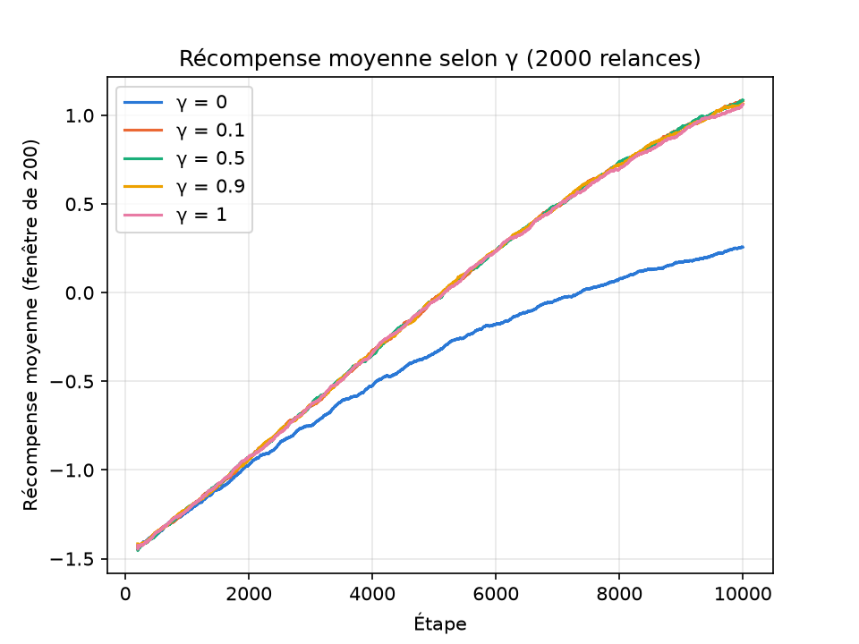

Moyennes obtenues sur 2000 relances (erreur type de 0.001) :

| 𝛾 | Récompense moyenne sur les 10000 étapes | Récompense moyenne sur les 1000 dernières étapes |
|------|------|------|
| 0 | -0.420 | 0.220 |
| 0.1 | -0.075 | 1.021 |
| 0.5 | -0.072 | 1.025 |
| 0.9 | -0.073 | 1.015 |
| 1 | -0.079 | 1.003 |

```python
gammas = [i / 20 for i in range(21)]
results = simulate_all([(gamma, 10000, 2000) for gamma in gammas])
```

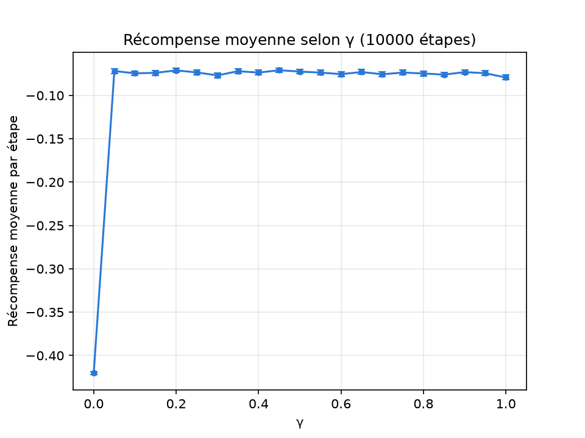

La meilleure valeur mesurée est 𝛾 = 0.45, mais elle ne se détache pas des autres : toutes les valeurs entre 0.05 et 0.95 donnent entre -0.071 et -0.077, pour une erreur type d'environ 0.001. Sur les 1000 dernières étapes, c'est même 𝛾 = 0.35 qui arrive en tête. On ne peut donc pas désigner une seule meilleure valeur.

La conclusion change tout de même par rapport à 1000 étapes : 𝛾 a maintenant un vrai effet. Avec 𝛾 = 0, l'IA est nettement moins bonne, car elle ne tient compte que de la récompense immédiate : elle sait manger un fruit voisin ou éviter un bord, mais pas se rapprocher d'un fruit lointain. Dès que 𝛾 > 0, la valeur du fruit se propage aux états voisins. 𝛾 = 1 est un peu en dessous des autres, probablement parce que rien n'atténue les récompenses lointaines dans cette tâche continue.

Les courbes montent encore à 10000 étapes : l'IA n'a pas fini d'apprendre.

## Exercice 4 - (Bonus) Snake plus long

### 1. Si on avait un serpent de 2 cases de long, quelles informations constitueraient l’état ?
- La position de la tete du snake
- La position de la queue du snake
- La direction du snake
- La position du fruit

### 2. Dans une grille 𝑁 × 𝑀 avec un serpent de taille 2, combien d’états seront possibles ?
N * M * 4 * (N * M - 2)

### 3. Implémentez le serpent de taille 2 dans votre classe ShortSnake.

```python
class ShortSnake:
    def __init__(self,taille,longueur=1):
        self.taille = taille
        self.longueur = longueur
        self.grille = []

        self.snake_pos = (taille // 2, taille // 2)
        self.snake_dir = Direction.EAST
        self.snake_tail = None
        if longueur == 2:
            self.snake_tail = (taille // 2 - 1, taille // 2)
        self._generer_fruit()
        self.score = 0
```

```python
def _generer_fruit(self):
    self.fruit_pos = self.snake_pos
    while(self.fruit_pos == self.snake_pos or self.fruit_pos == self.snake_tail):
        self.fruit_pos = (randint(0, self.taille - 1), randint(0, self.taille - 1))
```

```python
# Dans move, juste avant de mettre à jour snake_pos
if self.longueur == 2:
    self.snake_tail = self.snake_pos

self.snake_pos = (x, y)
```

```python
def save_state(self):
    return (self.snake_pos, self.snake_tail, self.snake_dir, self.fruit_pos)

def restore_state(self, state):
    self.snake_pos, self.snake_tail, self.snake_dir, self.fruit_pos = state
```

La queue s'affiche avec un « o » dans `__str__`. Nous avons vérifié la formule de la question 2 en jouant 200 000 coups au hasard sur une grille 5 x 5 : on retrouve exactement 5 * 5 * 4 * 23 = 2 300 états différents.

### 4. Modifiez votre classe GreedyPlayer si besoin.

Il n'y a rien à modifier. GreedyPlayer utilise uniquement save_state pour connaître l'état et move pour jouer. Les actions restent les mêmes, et le nouveau tuple peut toujours servir de clé dans le dictionnaire.

### 5. Tracez les mêmes graphiques que dans l’exercice précédent.

```python
def simulate(gamma, steps, runs, size=5, longueur=1):
    ...
    snake = ShortSnake(size, longueur)
    ...
```

**Une seule IA sur 1000 étapes**

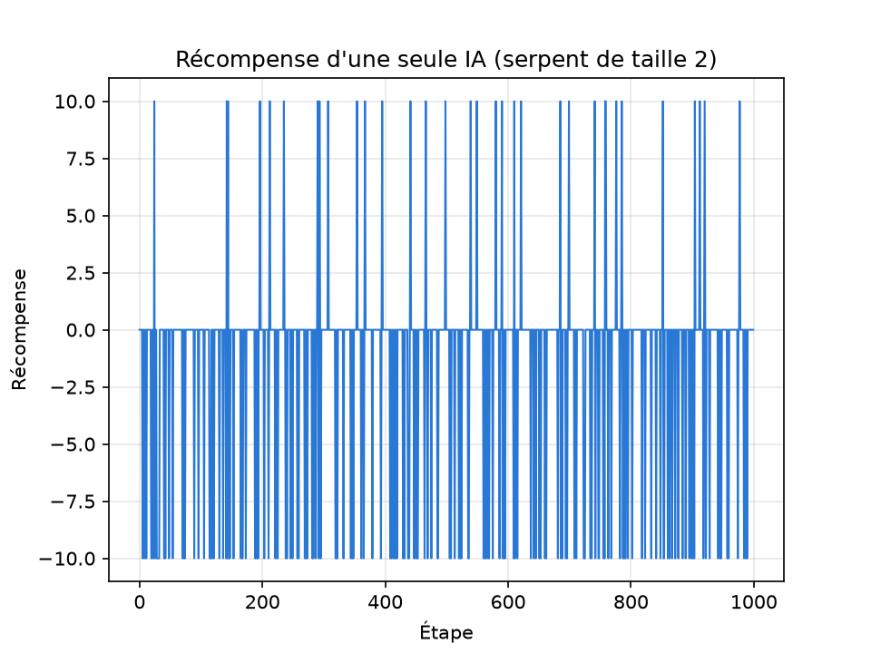

Comme dans l'exercice 3, le graphique est très bruité.

**Moyenne de 2000 relances sur 1000 étapes (𝛾 = 0.5)**

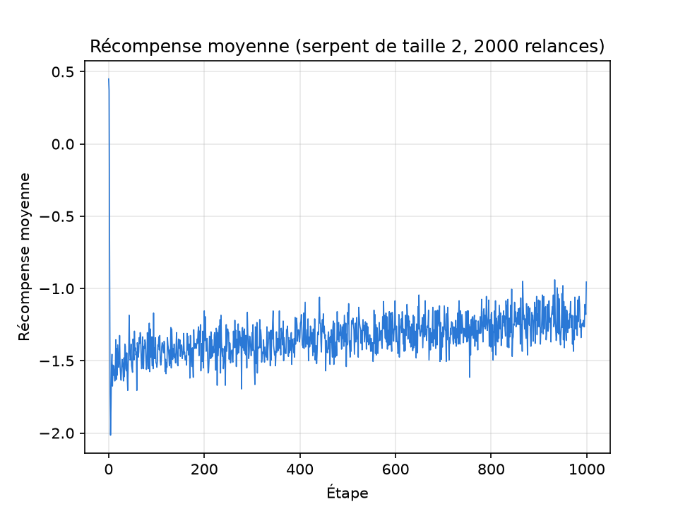

La récompense augmente doucement, avec une moyenne de -1.331 par étape.

**Comparaison de 𝛾 sur 1000 étapes**

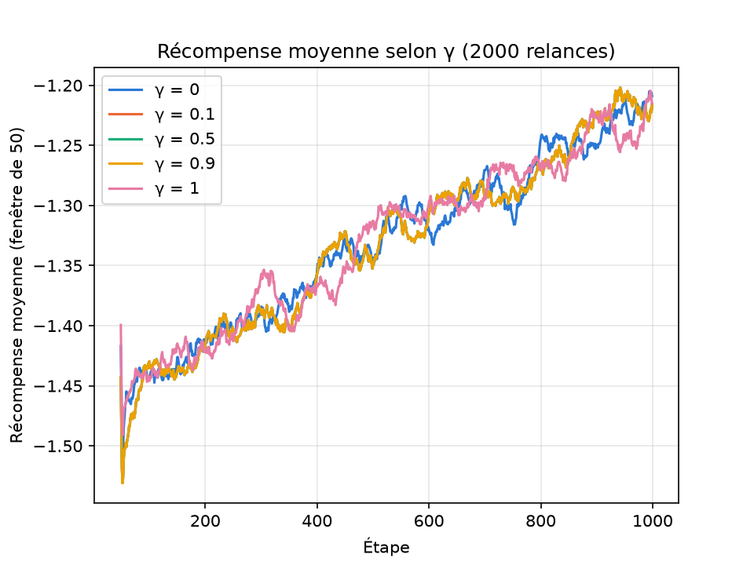

Moyennes obtenues sur 2000 relances (erreur type de 0.003) :

| 𝛾 | Récompense moyenne sur les 1000 étapes | Récompense moyenne sur les 100 dernières étapes |
|------|------|------|
| 0 | -1.330 | -1.212 |
| 0.1 | -1.331 | -1.214 |
| 0.5 | -1.331 | -1.214 |
| 0.9 | -1.331 | -1.214 |
| 1 | -1.329 | -1.228 |

**Recherche de 𝛾 sur 1000 étapes (10000 relances)**

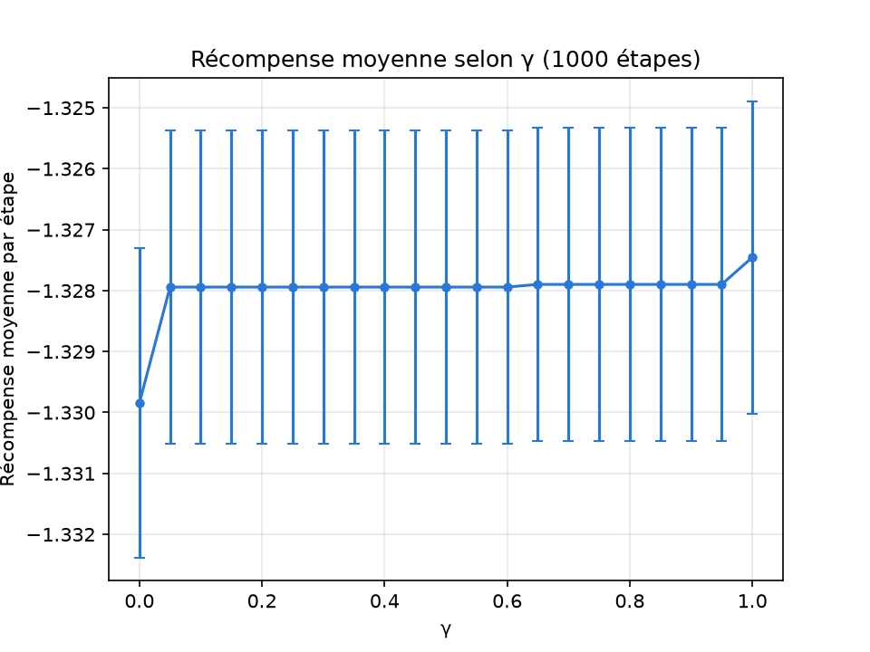

| 𝛾 | Récompense moyenne |
|------|------|
| 0 | -1.3298 |
| 0.05 à 0.95 | -1.3279 |
| 1 | -1.3275 |

Comme dans l'exercice 3, 𝛾 n'a presque aucun effet sur 1000 étapes. L'écart maximum est de 0.0023 pour une erreur type de 0.0013, donc on ne peut pas désigner de meilleure valeur.

**Comparaison de 𝛾 sur 10000 étapes**

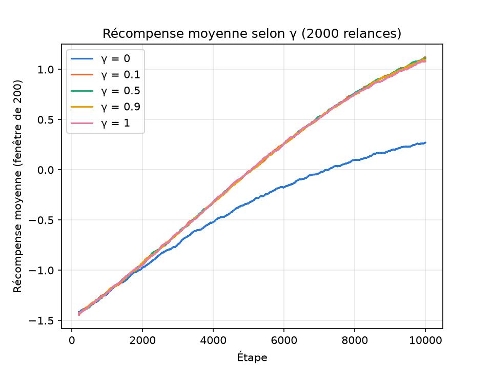

Moyennes obtenues sur 2000 relances (erreur type de 0.001) :

| 𝛾 | Récompense moyenne sur les 10000 étapes | Récompense moyenne sur les 1000 dernières étapes |
|------|------|------|
| 0 | -0.410 | 0.241 |
| 0.1 | -0.055 | 1.051 |
| 0.5 | -0.054 | 1.052 |
| 0.9 | -0.059 | 1.041 |
| 1 | -0.059 | 1.026 |

**Recherche de 𝛾 sur 10000 étapes**

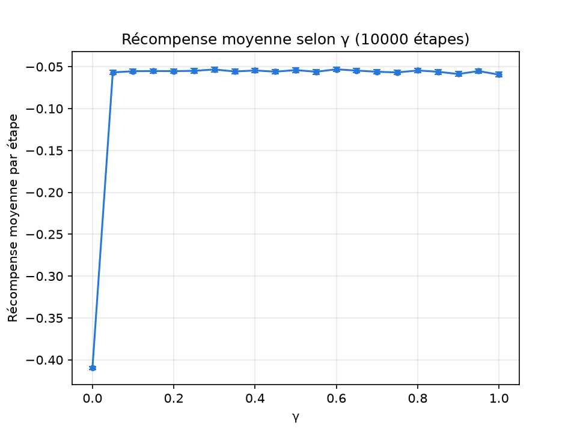

La meilleure valeur mesurée est 𝛾 = 0.60, mais 𝛾 = 0.30 est presque au même niveau. Toutes les valeurs de 0.05 à 0.95 sont entre -0.053 et -0.059, avec une erreur type de 0.0014. On retrouve donc la même conclusion que dans l'exercice 3 : 𝛾 = 0 est nettement moins bon, 𝛾 = 1 est un peu en dessous, et les autres valeurs ne se départagent pas.

### 6. Comparez la vitesse d’accroissement de la récompense pour votre nouvelle version avec la version du serpent à une seule case.

```python
longueurs = [1, 2]
results = simulate_all([(0.5, 10000, 2000, 5, longueur) for longueur in longueurs])
```

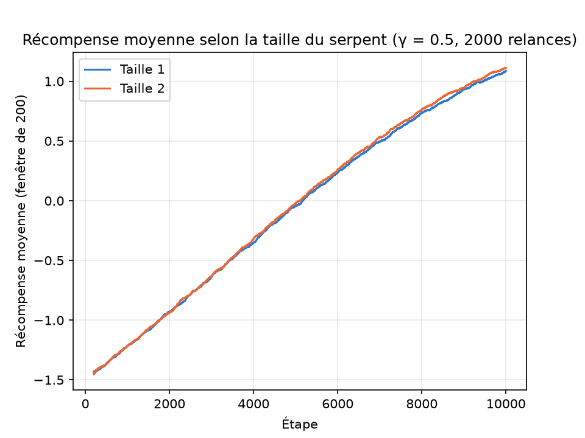

Récompense moyenne par tranche de 1000 étapes (𝛾 = 0.5, 2000 relances) :

| Étapes | Taille 1 | Taille 2 |
|------|------|------|
| 1 à 1000 | -1.331 | -1.326 |
| 2001 à 3000 | -0.757 | -0.750 |
| 4001 à 5000 | -0.158 | -0.141 |
| 6001 à 7000 | 0.395 | 0.422 |
| 9001 à 10000 | 1.025 | 1.052 |
| **Moyenne sur les 10000 étapes** | **-0.073** | **-0.054** |

La vitesse d'accroissement est quasiment la même : la récompense gagne environ 0.26 toutes les 1000 étapes dans les deux cas. Les courbes sont superposées au début, puis le serpent de taille 2 passe légèrement devant. L'écart final de 0.03 est petit, mais il est plus grand que le bruit.

Ce résultat s'explique car le serpent de taille 2 n'est pas vraiment plus compliqué. Sa queue est toujours la case qu'il vient de quitter, donc on peut la déduire de la position de la tête et de la direction. L'IA a donc le même type d'information qu'avant, et il y a même un peu moins d'états : 2 300 contre 2 400 sur une grille 5 x 5. Le petit avantage vient probablement de là, et du fait que le fruit ne peut plus apparaître juste derrière la tête.
